<p align="center">
  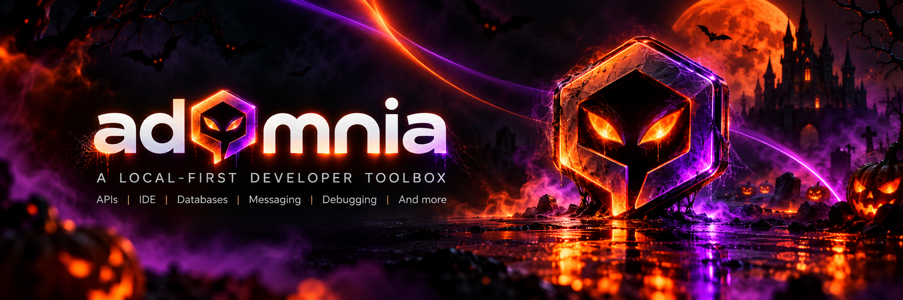
</p>

<p align="center">
  <strong>API development, Go debugging and service inspection in one desktop application.</strong><br>
  An API workbench and Code Studio with database, messaging, logs and profiling tools.
</p>

<p align="center">
  <a href="https://github.com/Andrea-Cavallo/adOmnia/releases/latest">Download</a> ·
  <a href="https://www.youtube.com/watch?v=tefwLUadRr8">Watch the demo</a> ·
  <a href="docs/GETTING-STARTED.md">Getting started</a> ·
  <a href="docs/QUICKSTART.it.md">Guida in italiano</a>
</p>

<p align="center">
  <strong>English</strong> · <a href="README.es-ES.md">Español</a> · <a href="README.ja.md">日本語</a> · <a href="README.zh-CN.md">简体中文</a>
</p>

<p align="center">
  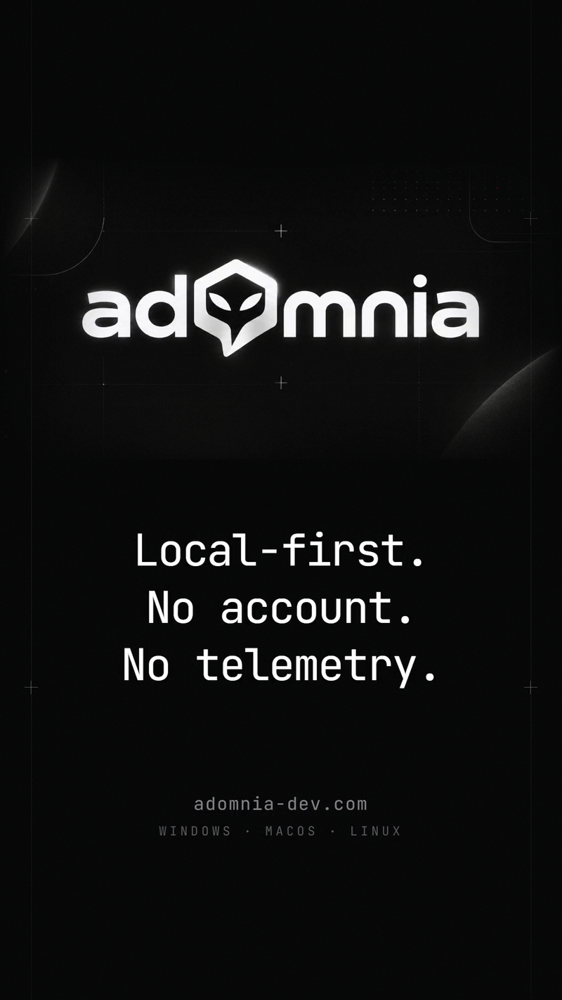
</p>

## adOmnia is written in Go!

<p align="center">
  Kubernetes is written in Go<br>
  Prometheus is written in Go<br>
  Terraform is written in Go<br>
  Docker is written in Go<br>
  Google created Go<br>
  Cloudflare uses Go<br>
  Uber uses Go<br>
  Dropbox uses Go<br>
  Twitch uses Go<br><br>
  <strong>Fast compilation. Simple concurrency. Built for infrastructure.</strong><br>
  <strong>Go is the way to Go. adOmnia is written in Go: speed is the point.</strong>
</p>

## One window for your code, your endpoints, your debugger and your database

A backend developer's day is usually an editor, a terminal, an API client, a database GUI, a Docker dashboard, a Kafka tool and a browser with DevTools, none of which know about each other. adOmnia ends the switching: a local-first desktop IDE whose centerpiece is **Code Studio**, wrapping every tool you touch in one minimal, modern interface where the code, the endpoints, the debugger, the database and the brokers know about each other. [Watch it in action](https://www.youtube.com/watch?v=tefwLUadRr8&t=24s).

- **Complete development tooling.** gopls completion, diagnostics and refactorings, run/test/debug from the gutter, a Delve debugger (launch, attach or remote), pprof and escape-analysis workbenches, a Git workbench with hunk staging, and several isolated projects open at once. Java and Spring, and the web languages, follow the same standards.
- **Endpoints discovered from the code.** Opening a project builds a local map of modules, services, datasources, `.env` variables, OpenAPI/proto/WSDL contracts and HTTP routes (net/http, gin, echo, chi, gorilla; Spring MVC). Press `Ctrl+K` to jump to a route, table, topic or service and act on it: send it, open its handler, mock it, query it. No more copying ports into an API client.
- **Request-level debugging.** *Debug Request* starts your service under the debugger, waits for the port, sends the request and stops on the breakpoint that handles it. Requests can target a service by name, resolved to your local run, a Compose port or a remote URL, and show the SQL and Kafka traffic they cause.
- **Database, brokers and Docker in the same interface.** Database Studio (PostgreSQL, MySQL/MariaDB, MongoDB with an explorer and aggregation builder), Broker Studio, Docker Lab, Mock Server, Proxy and Browser Debugging, load testing, WebSocket/SSE/gRPC/SOAP clients. Opening a tool from a detected service arrives already configured.
- **Minimal, modern and yours to shape.** One design language across every panel, light and dark themes, importable skins, a JavaScript plugin system, shareable templates and Git-friendly workspaces.
- **Local-first.** No cloud, no account, no telemetry. Project tools run only after you explicitly trust a project, and every tool install shows its exact command first. One portable executable, written in Go: it starts fast and stays fast.

The glue between the tools is the product: when the IDE knows your routes, the API client knows which service to start, the debugger can stop inside the request you just sent and the database tool is already on the right schema, the loop from *I changed a line* to *I saw what it did* collapses from minutes to seconds.

## Tour of adOmnia

### Workspace Hub

Start here. The hub shows your recent activity and opens every area: Code Studio, API & Protocols, Data & Messaging, Docs & Payloads and Power Tools.

<p align="center">
  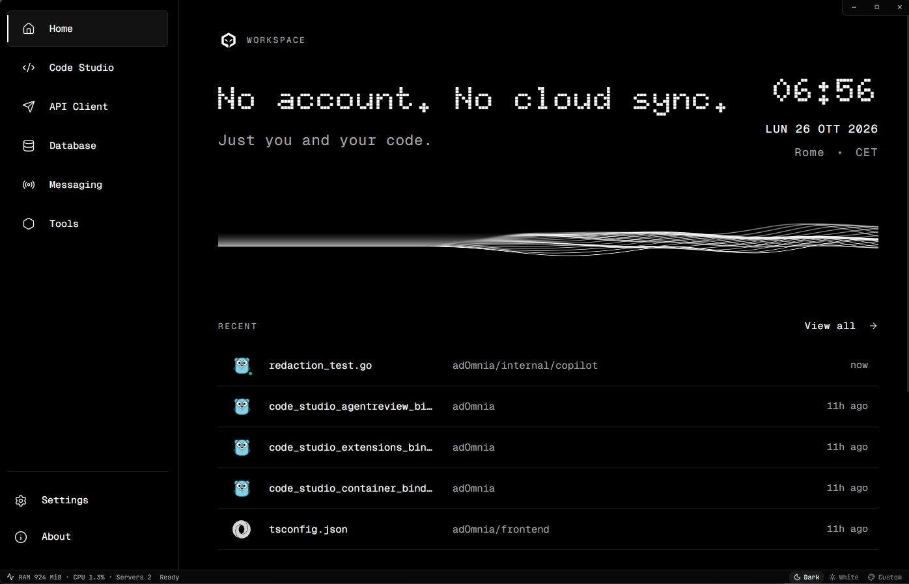
</p>

### Custom Hub: your own colors

Pick one accent color and a dark base: the whole app follows, from the rail to the hub and every studio. Shades adapt so text stays readable in Dark and White.

<p align="center">
  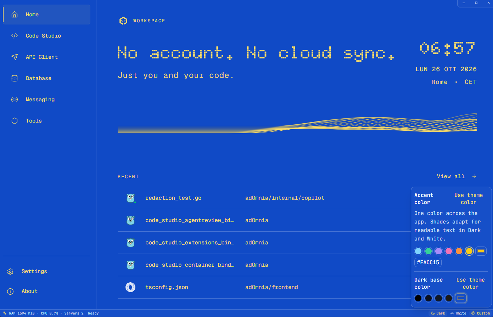
</p>

### Code Studio with Go

Project tree, gopls completion and usage counts, Build/Test/Vet lenses, run configurations, Git branch and the toolchain status in the footer.

<p align="center">
  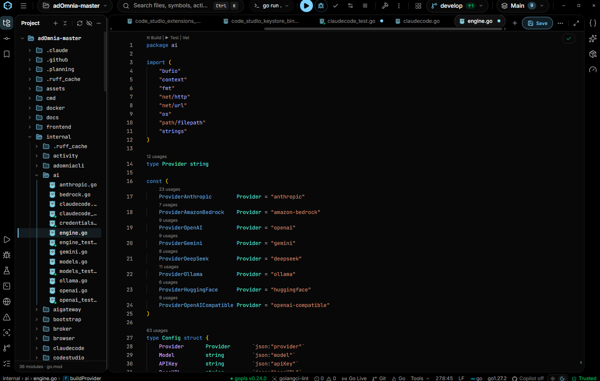
</p>

### Code Studio with Java

Same IDE, another language: a Maven/Spring project with Eclipse JDT LS, Javadoc and the same run, test and debug interface.

<p align="center">
  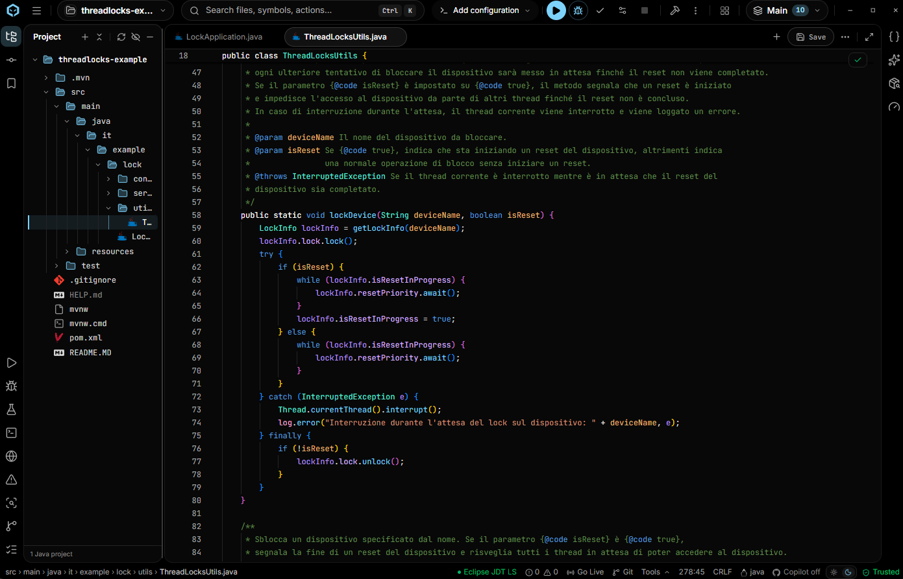
</p>

### Debugger

Stop on a breakpoint and inspect goroutines, call stack, locals and globals, with inline values in the editor, breakpoints, memory, disassembly and an evaluate console.

<p align="center">
  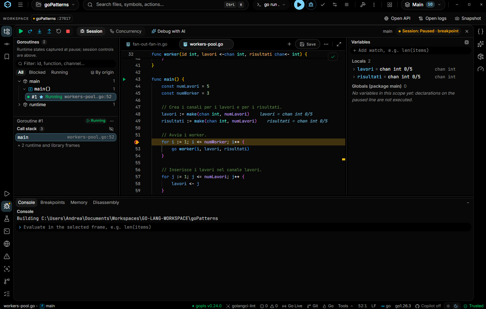
</p>

### AI Assistant

Ask Copilot, milk, Claude Code or OpenCode without leaving the editor. The assistant sees your project rules and the open file, and answers beside the code.

<p align="center">
  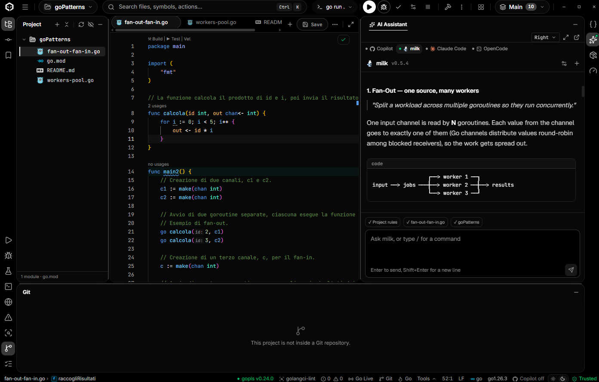
</p>

### Dependency vulnerabilities in `go.mod`

Every requirement shows inline actions (update, browse files, replace with local, remove). Known vulnerabilities appear as problems on the exact line, with the advisory ID.

<p align="center">
  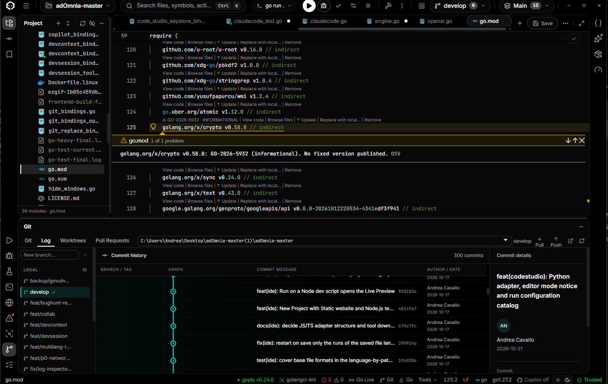
</p>

### Live Preview

Run a dev server and see the result inside Code Studio, next to the code, with navigation, device modes and the dev-server status in the footer.

<p align="center">
  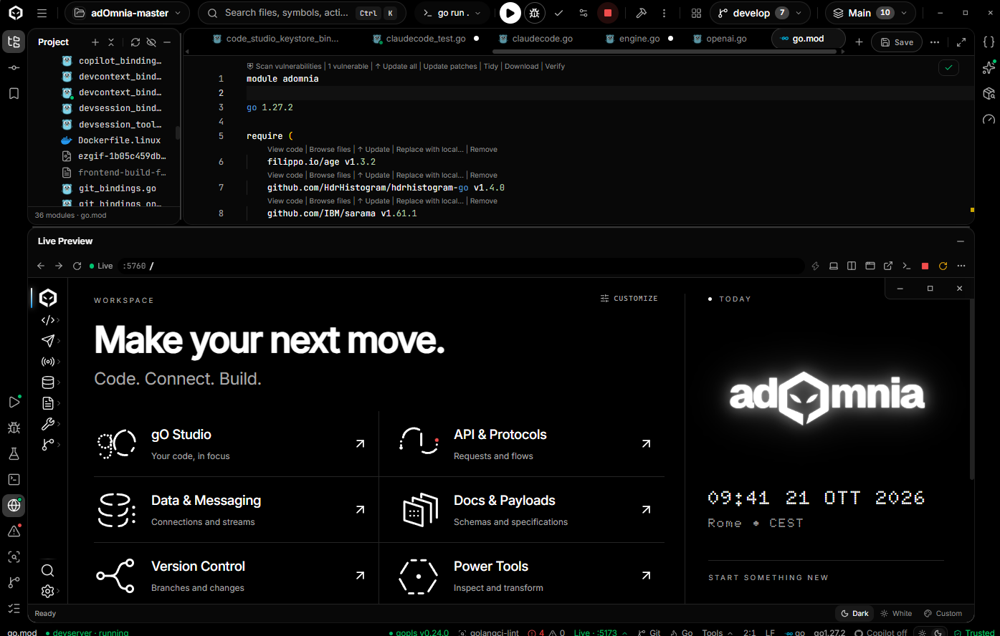
</p>

### API Workspace

Collections, environments and requests. Routes found in your code become requests, each linked to its handler with **Open in Code Studio**.

<p align="center">
  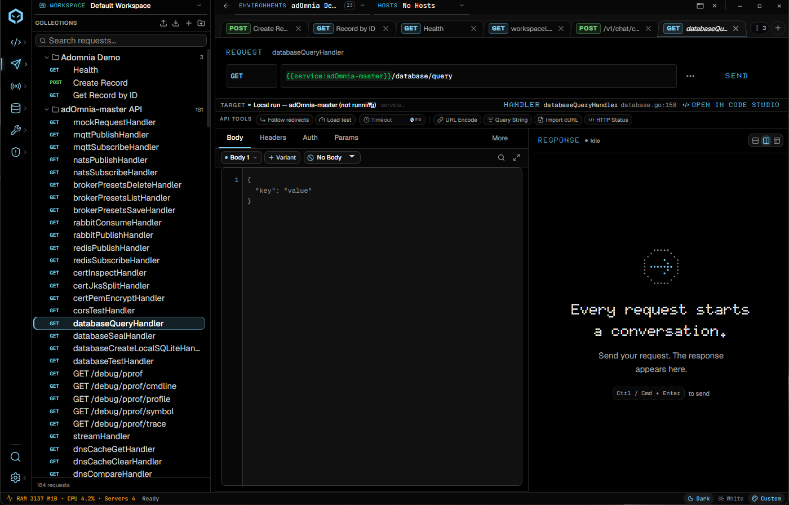
</p>

### Database Studio

Browse databases and collections, filter documents, run aggregations and inspect schema, indexes and validation. Shown here with MongoDB.

<p align="center">
  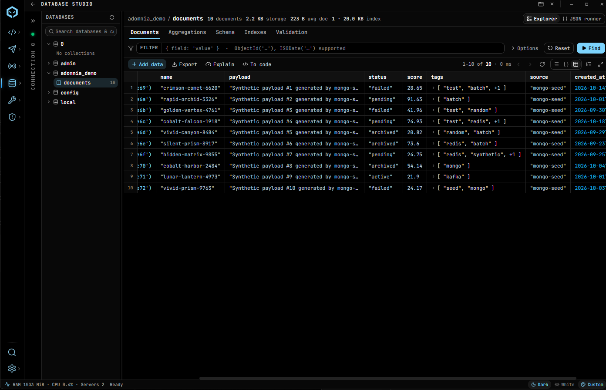
</p>

### Log Inspector

Open or paste logs, or follow them live. Search with filters, see fields detected automatically, group by request, and read each event as JSON, message, stack trace or context.

<p align="center">
  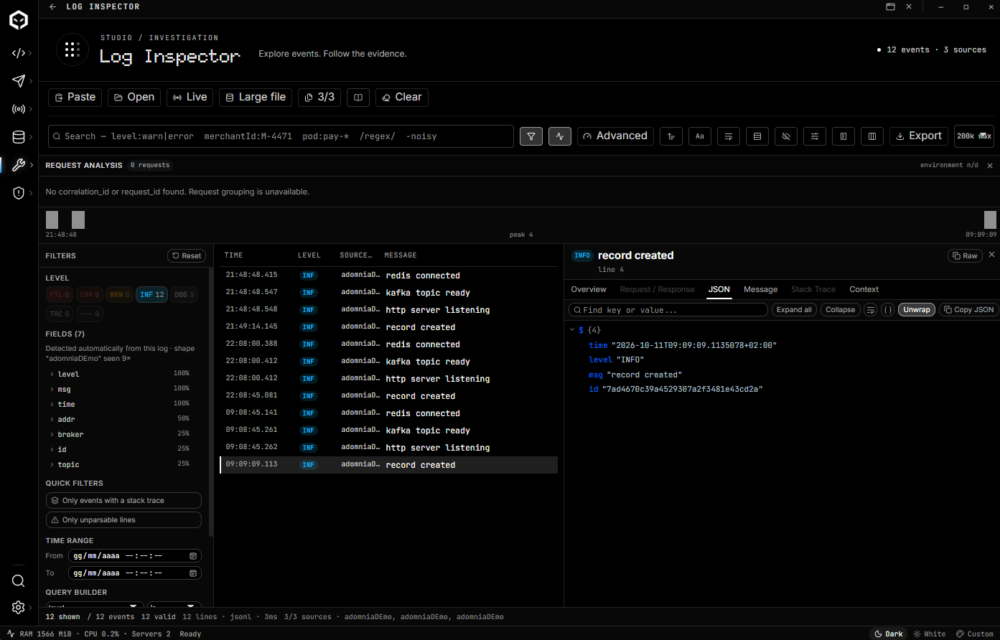
</p>

### Power Tools

19 utilities in one place: HAR Viewer, XML Tools, Observability, Secret Scanner, Docker Lab, Base64, hashes, HMAC, JWT decoder, PEM/JKS, Java decompiler and more.

<p align="center">
  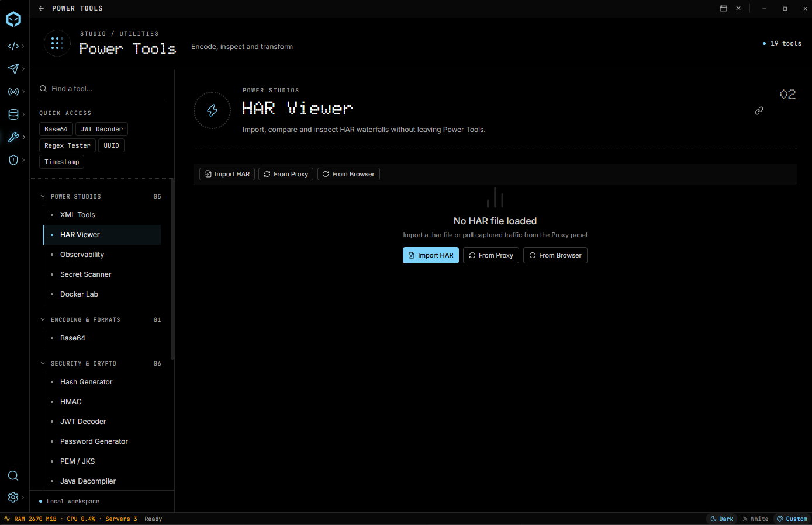
</p>

## Demo

**[▶ Watch the demo on YouTube](https://www.youtube.com/watch?v=tefwLUadRr8)**

*API Workspace showing a request, its response and the associated Go handler. Select the image to watch the demonstration.*

## API development and service debugging

adOmnia combines API testing and Go development. Requests can be linked to detected handlers, executed against a running service and inspected in the debugger. Database, messaging, log and trace tools share the application. With capture configured, follow the SQL, messages and logs associated with the live request.

A Go service started in **Code Studio** becomes a **live development session**. **API Workspace** can call and debug it; recognized routes link back to their source. Logs and configured SQL/broker captures are part of the same workflow.

```text
WRITE              RUN                CALL                 UNDERSTAND
Code Studio    →    Live service    →    API Workspace    →    Handler / breakpoint
                                                                ↕
                                                    Variables · logs · SQL · messages
```

### Core capabilities

| Capability | Description |
| --- | --- |
| **API testing and source navigation** | Reusable collections, environments, authentication and assertions, with a direct route into recognized Go handlers. Start with an API, then follow its implementation into the running code. |
| **Request-driven debugging** | Debug Request starts or reuses a compatible Delve session. Inspect frames, variables and goroutines, step through the handler and return to the response. |
| **Data and events beside the request** | Database, Broker, Log and Trace tools share the application. With capture configured, follow the SQL, messages and logs associated with the live request. |
| **Go development and profiling** | gopls editing and navigation, test/coverage workflows, Delve, pprof, execution traces and architecture/impact views connect source-level work with runtime investigation. |
| **Enterprise protocols in the same workflow** | HTTP, SOAP/WSDL, WS-Security, gRPC, WebSocket/SSE, mTLS and certificate tools support both modern APIs and existing systems. |
| **Dependency security with reviewed fixes** | Security Center scans `pom.xml` and `go.mod`, separates severity from exploitation signals, and previews the security impact of an upgrade before it happens. Safe remediation shows the diff, runs the checks and applies only after your review. |
| **Local storage and multiple windows** | Local collections and settings, exportable data, multiple Go projects and native studio windows. Arrange the IDE, API client and supporting tools across windows. |

### Storage and external services

**No account required to use the application.** Collections, settings and project state stay local. You choose the APIs, databases, brokers and optional AI providers to connect to. External providers and local services are chosen explicitly.

### Projects and windows

Keep a service in Code Studio, its requests in API Workspace and its database or broker beside them. Open another Go project in its own native window while staying inside the same adOmnia instance.

The workflow preserves links between the project, service session, API request and available diagnostic evidence.

## Start with your API

1. Open **API Workspace** and create a collection and request.
2. Choose a method and URL. Configure **Body**, **Headers**, **Params** and authentication.
3. Choose an environment for reusable values such as `{{baseUrl}}`.
4. Press **SEND**. Inspect the status, timing, response body, headers and test results.
5. Save the request to rerun it or share an export.

You can use the API tools without opening a Go project.

| Workflow | Tools in the same workspace |
| --- | --- |
| Test HTTP APIs | Collections, environments, authentication, response inspection and assertions |
| Work with enterprise protocols | SOAP/WSDL, WS-Security, gRPC, mTLS and certificate tools |
| Follow live connections | WebSocket and SSE clients |
| Reproduce responses | Mock server and proxy/interceptor tools |
| Inspect service data | Database Studio and Broker Studio |
| Understand failures | Browser debugging, logs, traces and the connected Go debugger |

## Follow a request into Go code

1. Open the service in **Code Studio → File → Open Project**.
2. Trust the folder to enable Go tools. Configure the SDK and Run/Debug configuration.
3. Set a handler breakpoint and start debugging, or use **Debug Request** from the API request actions.
4. Send the matching request. For a recognized route, the **HANDLER** strip links to its source with **OPEN IN GO IDE**.
5. Inspect the paused frame, variables, stack and goroutines. Step or continue, then return to the response.

SQL, broker messages and logs enrich this workflow when capture/instrumentation is configured. They are not automatically available for every service. See [the walkthrough](docs/GETTING-STARTED.md) for a first setup.

## Code Studio: the IDE inside the workflow

- **Edit and navigate:** gopls completion, diagnostics, references, rename, refactoring, project search and Git.
- **Run, test and debug:** Go configurations, test explorer, coverage and Delve with conditional breakpoints and goroutine inspection.
- **More than Go:** TypeScript/JavaScript and web projects (Vite/npm scripts, Vitest/Jest results, Live Preview) and Java (Maven/Gradle, JUnit, Spring Boot, breakpoints and remote attach) use the same run, test and debug interface. In `pom.xml`, check for newer versions on Maven Central and scan dependencies for known vulnerabilities, with a one-click version update. Language servers and debuggers are installed only after you confirm the exact command.
- **Understand the project:** routes, dependencies, interfaces, architecture and change-impact views.
- **Measure behavior:** pprof profiles, execution traces, benchmarks and concurrency tools.
- **Keep work together:** terminal, local history, recovery snapshots and multiple projects/windows within one adOmnia instance.
- **AI assistance:** contextual assistance with configured providers and project policies; review changes before applying them.

> **Upgrading to Go 1.27?** Reinstall the Go tools you already have: golangci-lint, staticcheck, gopls and Delve. Tools built with an older Go cannot read Go 1.27 packages. For example, golangci-lint 2.5.0 built with Go 1.25 reports `export data version 5 is greater than maximum supported version 2` on a Go 1.27 project, while the same binary works on a Go 1.26.5 project. Rebuild each tool with Go 1.27 (`go install <tool>@latest`); Code Studio's own installs already use `@latest`.

Open another project from the project selector. Choose **Open Project in New Window** to place it beside the first IDE; save or discard unsaved files before moving it. Use the **Studios** menu for surrounding tools and workspaces.

[Read the Code Studio guide →](docs/CODE-STUDIO.md) · [Technical reference: the IDE platform →](docs/CODE-STUDIO-REFERENCE.md)

## Download and install

Get adOmnia from **[GitHub Releases](https://github.com/Andrea-Cavallo/adOmnia/releases/latest)**. Check the release page for available assets and known limitations.

| Platform | Download | Setup |
| --- | --- | --- |
| Windows x64 | `adomnia-<version>-windows-amd64.exe` | Requires WebView2; executable/per-user installation, not an MSI wizard |
| macOS Intel / Apple Silicon | `adomnia-<version>-macos-universal.dmg` | Install from the DMG; check signing details in release notes |
| Linux x64 | `adomnia-<version>-linux-amd64-gtk3-webkitgtk-4.1.tar.gz` | Requires GTK 3 and WebKitGTK 4.1 |

Check for updates in **Settings**. Update packages verify the publisher signature and checksum; installation asks for confirmation. OS code signing is separate from updater package signing.

[Installation and updates](docs/INSTALL.md) · [Release notes and support limits](docs/releases/v1.0.0.md)

## Connect Claude (or any MCP client) to adOmnia

adOmnia ships a local [MCP](https://modelcontextprotocol.io) server over stdio: `adomnia mcp [collection-folder]`. No port, no account, nothing leaves your machine. The agent can read and run your collections and drive the mock server.

Register it in Claude Code (use the full path of the adOmnia executable; the optional last argument is the default collection folder, exported with *Export to folder*):

```bash
claude mcp add adomnia -- "C:\path\to\adomnia.exe" mcp "C:\path\to\my-collection"
```

Claude Desktop, Cursor and other clients take the same command in their JSON config:

```json
{
  "mcpServers": {
    "adomnia": {
      "command": "C:\\path\\to\\adomnia.exe",
      "args": ["mcp", "C:\\path\\to\\my-collection"]
    }
  }
}
```

| Tool | What it does |
| --- | --- |
| `collection_list_requests` | List the requests of a collection (id, name, method, url, folder) |
| `collection_get_request` | One request in full (headers, params, bodies, auth, assertions, scripts) by id |
| `collection_list_environments` | Environments and their variable names |
| `collection_run` | Run requests and their tests against real endpoints; filter by `folder`, `env`, `vars` |
| `mock_start` / `mock_stop` / `mock_status` | Start the local mock server from a config (`port`, `endpoints`), stop it, check it |
| `mock_hits` / `mock_clear_hits` | See what your code actually sent to the mock, or reset the log |

Every tool carries a title and read-only / destructive / open-world hints, so clients can auto-approve the safe ones and ask before the rest.

**Resources.** The collection is also readable without calling a tool: `adomnia://collection` (summary), `adomnia://collection/request/{id}` and `adomnia://collection/environment/{name}`, listed by `resources/list` and described by templates.

**Prompts.** `test_endpoint` (read, run and explain one request), `run_collection_report` (run a folder and summarise failures) and `mock_dependency` (stand in for an upstream API, then check what your code sent).

**Secrets stay home.** Passwords, tokens, API keys, `Authorization` headers and cookies are masked (`***`) in everything the server returns, in requests and in environments. `collection_run` still uses the real values to call your endpoints.

**Protocol.** MCP `2025-06-18`, `2025-03-26` and `2024-11-05` (the client's version is echoed); standard JSON-RPC errors (`-32700` parse, `-32601` unknown method, `-32602` bad params, `-32002` resource not found); `ping` and `logging/setLevel` answered.

Try it: ask Claude *"list the requests in my adOmnia collection, then run the `auth` folder"*, or *"start a mock for GET /ping and tell me what my service sent to it"*. Check the connection with `claude mcp list`.

### adOmnia as an MCP client

The **MCP** panel connects adOmnia to any other MCP server, over **stdio** (a command you run locally) or **Streamable HTTP** (a URL, optionally with a bearer token), so you can inspect and call its tools, read its resources and try its prompts from one place. Several servers can be connected at once.

- **Handshake and versions.** Offers `2025-06-18`, accepts the older revision the server answers with, and repeats it in `MCP-Protocol-Version` on HTTP. The server's `instructions` and capabilities are kept.
- **HTTP details.** Plain JSON or `text/event-stream` answers, the `Mcp-Session-Id` handed out by the server (repeated on every call and closed with `DELETE`), and clear errors for a rejected token or a session the server forgot.
- **stdio details.** Answers are matched to calls by id, so concurrent calls never swap results; notifications and server `ping` requests in between are handled; a cancelled call does not disturb the next one. When a server dies, the error includes the end of its stderr, and the session shows **crashed** (non-zero exit) or **stopped**.
- **Everything the protocol lists.** Tools, resources, resource templates and prompts follow `nextCursor` across pages; `resources/read` returns text or base64 blobs; tool results keep text, image, audio, resource-link and embedded-resource blocks plus `structuredContent`; prompt arguments are sent as strings, as the spec requires.
- **Safe by default.** Calls without a deadline time out after two minutes; replies over 16 MB are refused; `ping` checks that a session is alive; restarting a session reuses its saved configuration.

Everything runs on your machine: adOmnia only talks to the servers you configure.

## What is experimental

LAN collaboration is **beta and opt-in**. Standalone LaTeX, Kubernetes/OpenShift, plugin marketplace and Hub games are hidden from v1 navigation. Imported PDFs still open the complete PDF editor, but platform support is limited by the underlying OS and toolchain.

## Documentation

| Start here | What it helps you do |
| --- | --- |
| [Getting started](docs/GETTING-STARTED.md) · [Italian guide](docs/QUICKSTART.it.md) | Send requests, connect a Go project and debug a handler |
| [Installation](docs/INSTALL.md) | Install, update and check platform requirements |
| [Code Studio](docs/CODE-STUDIO.md) | Configure projects, tools, tests, debugger and editor |
| [Code Studio technical reference](docs/CODE-STUDIO-REFERENCE.md) | Understand the IDE platform: architecture, modules, language adapters, UI and bindings |
| [Live sessions](docs/LIVE-SESSION.md) | Connect requests with code, logs, SQL and messages |
| [Feature reference](docs/adomnia-feature-catalog.en.md) | Explore the supporting studios |
| [Troubleshooting](docs/TROUBLESHOOTING.md) · [FAQ](docs/FAQ.md) | Resolve setup and workflow problems |
| [Build from source](docs/BUILD.md) · [Contributing](CONTRIBUTING.md) | Build the application and contribute |

Resource diagnostics: adjust the backend Go GC budget live, restart gopls with a chosen limit, record CPU/RAM and export process ownership/history as JSON, CSV, Markdown or HTML with charts. [Measured results and scope](docs/performance/resources-2026-10-19.md).

## Feedback and contributions

[Report an issue](https://github.com/Andrea-Cavallo/adOmnia/issues) with your version, operating system and reproduction steps. Remove credentials and private data from screenshots and exports. Follow repository contribution guidelines before opening a pull request.

[MIT license](LICENSE.md)

Python in Code Studio: script/module Run, structured pytest tests (optional coverage with pytest-cov), debugpy debugging with exception breakpoints and explicit local attach, Ruff formatting on request and basedpyright editing assistance, with per-unit interpreter discovery and selection; each unit runs its own language server, so two virtualenvs never share an interpreter. FastAPI/Flask/Django routes open in the API client, Project Services preselects Database and Broker Studio from the project manifests, and Security Center scans Python dependencies through the PyPI ecosystem, with CVE lenses and one-click fixes in `requirements*.txt`/`pyproject.toml`, a Python tab in Module dependencies, and an "API docs" handoff from the Run console to the API client's OpenAPI import. All tools are used from your local environments or installed explicitly with visible, pinned commands, and downloaded artifacts are verified against the SHA-256 reported at install time; nothing is installed silently. Notebooks and remote debugging remain planned. Desktop acceptance is pending. See [Code Studio](docs/CODE-STUDIO.md).

Run configurations provide project-aware creation, searchable saved entries and types, review of detected targets, and protection for unsaved edits. See [Code Studio](docs/CODE-STUDIO.md) for the current workflow and acceptance limits.

Claude Code and milk chat share filtered live project context and support explicit text and image attachments. Model selectors follow agent capabilities. milk's own slash commands are read from the agent (`/workflow`, `/bg`, `/tasks`, `/usage`, `/memory`, `/escalate`, `/primary`, …) and offered in a keyboard palette in the composer, so workflows, background agents and plans are usable without guessing syntax; background-agent follow-up turns appear as a marked assistant response instead of being dropped. Images use native ACP blocks when the agent advertises them, otherwise a private temporary `@<path>` reference deleted at the end of the turn — the same convention milk's TUI uses — so Claude Code can read them while a text-only local model cannot. Milk 0.7 exposes configured-agent selection, routing/reasoning controls and task plans; native provider acceptance remains pending. See [Code Studio](docs/CODE-STUDIO.md).
