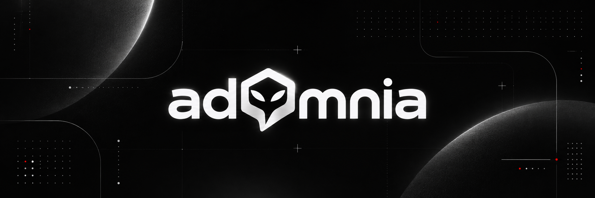
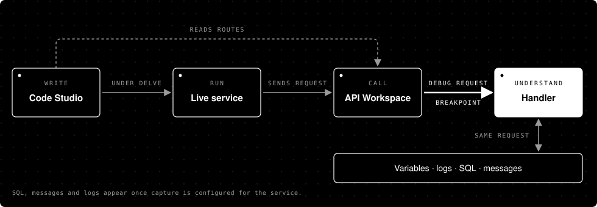

<p align="center">
  <a href="https://github.com/sponsors/Andrea-Cavallo"></a>
</p>

<p align="center">
  
</p>

<p align="center">
  <strong>A local-first desktop IDE to run, test and debug the code your AI agent writes.</strong><br>
  Routes, API client, Delve debugger, database and brokers in one window. No account, no cloud, no telemetry.
</p>

<p align="center">
  <a href="https://github.com/Andrea-Cavallo/adOmnia/releases/latest"></a>
  <a href="LICENSE"></a>
  
  
  <a href="https://github.com/Andrea-Cavallo/adOmnia"></a>
  <a href="https://github.com/Andrea-Cavallo/adOmnia/releases"></a>
</p>

<p align="center">
  <a href="https://github.com/Andrea-Cavallo/adOmnia/actions/workflows/build.yml"></a>
  <a href="https://codecov.io/gh/Andrea-Cavallo/adOmnia"></a>
  <a href="https://github.com/Andrea-Cavallo/adOmnia/actions/workflows/quality.yml"></a>
  <a href="https://github.com/Andrea-Cavallo/adOmnia/actions/workflows/codeql.yml"></a>
  <a href="https://securityscorecards.dev/viewer/?uri=github.com/Andrea-Cavallo/adOmnia"></a>
  <a href=".github/dependabot.yml"></a>
</p>

<p align="center">
  <sub>Listed in <a href="https://github.com/Andrea-Cavallo/awesome-wails">awesome-wails</a> and <a href="https://github.com/Andrea-Cavallo/awesome-api-clients">awesome-api-clients</a>.</sub>
</p>

<p align="center">
  <a href="https://github.com/Andrea-Cavallo/adOmnia/releases/latest"><strong>Download for Windows (.exe)</strong></a> ·
  <a href="https://github.com/Andrea-Cavallo/adOmnia/releases/latest"><strong>Download for macOS (.dmg)</strong></a> ·
  <a href="https://github.com/Andrea-Cavallo/adOmnia/releases/latest"><strong>Download for Linux (.tar.gz)</strong></a>
</p>

<p align="center">
  <a href="https://www.youtube.com/watch?v=tefwLUadRr8">Watch the demo</a> ·
  <a href="docs/GETTING-STARTED.md">Getting started</a> ·
  <a href="docs/QUICKSTART.it.md">Guida in italiano</a>
</p>

<p align="center">
  <strong>English</strong> · <a href="README.es-ES.md">Español</a> · <a href="README.ja.md">日本語</a> · <a href="README.zh-CN.md">简体中文</a>
</p>

<p align="center"><sub>Star the repository and choose Watch → Releases to follow progress.</sub></p>

## The problem

AI agents now write a large share of backend code. Checking it is the slow part: start the service, find the port, open an API client, attach a debugger, inspect the database. Each step lives in a different tool, and none of them knows about the others.

adOmnia puts that loop in one window. It reads your routes from the code, so the API client and the debugger already know which service and handler a request belongs to.

## Try it in 2 minutes

1. **Download and open it.** See [Download and install](#download-and-install) for the SmartScreen / Gatekeeper prompt on first launch.
2. In **Code Studio**, choose **File → Open Project** and pick a Go service. Trust the folder when asked.
3. Press `Ctrl+K` and search for one of your routes.
4. Choose **Debug Request** and set a breakpoint in the handler.
5. The service starts under Delve, the request is sent, and execution stops on your breakpoint.

A step-by-step version is in [Getting started](docs/GETTING-STARTED.md).

## What you get

- **Endpoints discovered from the code.** Opening a project builds a local map of modules, services, datasources, `.env` variables, OpenAPI/proto/WSDL contracts and HTTP routes (net/http, gin, echo, chi, gorilla; Spring MVC; FastAPI, Flask, Django). `Ctrl+K` jumps to a route, table, topic or service and acts on it: send it, open its handler, mock it, query it.
- **Request-level debugging.** *Debug Request* starts your service under Delve, waits for the port, sends the request and stops on the breakpoint that handles it. Requests can target a service by name, resolved to your local run, a Compose port or a remote URL, and show the SQL and Kafka traffic they cause.
- **A full IDE for Go, Java and the web.** gopls completion, diagnostics and refactoring; run, test and debug from the gutter; pprof and escape-analysis workbenches; a Git workbench with hunk staging; several isolated projects open at once. Java/Spring, TypeScript/JavaScript and Python follow the same run, test and debug interface.
- **Data and messaging beside the request.** Database Studio (PostgreSQL, MySQL/MariaDB, MongoDB, Redis), Broker Studio, Docker Lab, Mock Server, Proxy, Browser Debugging, load testing and WebSocket/SSE/gRPC/SOAP clients. Opening a tool from a detected service arrives already configured.
- **Enterprise protocols.** SOAP/WSDL, WS-Security, mTLS, JKS and certificate tools sit in the same workspace as modern HTTP APIs.
- **Dependency security.** Security Center scans `pom.xml`, `go.mod` and Python manifests, separates severity from exploitation signals, and previews the impact of an upgrade. Fixes show the diff and apply only after review.
- **Local-first and extensible.** No cloud, no account, no telemetry. Project tools run only after you trust a project, and every tool install shows its exact command first. Light and dark themes, importable skins, a JavaScript plugin system, shareable templates and Git-friendly workspaces. One portable executable.

<p align="center">
  
</p>

## Tour of adOmnia

### Workspace Hub

Start here. A time-of-day greeting and a dot-matrix clock sit above **Continue coding**, which reopens your last file together with its project. The recent list keeps the files you worked on most recently, and the sidebar opens Code Studio, the API Client, Database, Messaging, Tools, Settings and About.

<p align="center">
  
</p>

### Custom Hub: your own colors

Pick one accent color and a dark base from **Settings → Appearance**, or start from a preset (**Anthracite**, Black/White, White/Black). The whole app follows, from the rail to the hub and every studio. Shades adapt so text stays readable in Dark and White.

<p align="center">
  
</p>

### Code Studio with Go

Project tree with Git markers and hover actions, gopls completion and usage counts, Build/Test/Vet lenses, run configurations with running/starting/retry states, and a compact chrome: project and branch centered in the top bar, a searchable list of open files beside the tabs, collapsible tool windows, and the file name with its enclosing symbols in the status bar, next to line:column and the Go SDK.

<p align="center">
  
</p>

### Code Studio with Java

Same IDE, another language: a Maven/Spring project with Eclipse JDT LS, Javadoc and the same run, test and debug interface.

<p align="center">
  
</p>

### Debugger

Stop on a breakpoint and inspect goroutines, call stack, locals and globals, with inline values in the editor, breakpoints, memory, disassembly and an evaluate console.

<p align="center">
  
</p>

### AI Assistant

Ask Copilot, milk, Claude Code or OpenCode without leaving the editor. The assistant sees your project rules and the open file, and answers beside the code.

<p align="center">
  
</p>

### Dependency vulnerabilities in `go.mod`

Every requirement shows inline actions (update, browse files, replace with local, remove). Known vulnerabilities appear as problems on the exact line, with the advisory ID.

<p align="center">
  
</p>

### Live Preview

Run a dev server and see the result inside Code Studio, next to the code, with navigation, device modes and the dev-server status in the footer.

<p align="center">
  
</p>

### API Workspace

Collections, environments and requests. Routes found in your code become requests, each linked to its handler with **Open in Code Studio**.

<p align="center">
  
</p>

### Database Studio

Browse databases and collections, filter documents, run aggregations and inspect schema, indexes and validation. Shown here with MongoDB.

<p align="center">
  
</p>

### Log Inspector

Open or paste logs, or follow them live. Search with filters, see fields detected automatically, group by request, and read each event as JSON, message, stack trace or context.

<p align="center">
  
</p>

### Power Tools

19 utilities in one place: HAR Viewer, XML Tools, Observability, Secret Scanner, Docker Lab, Base64, hashes, HMAC, JWT decoder, PEM/JKS, Java decompiler and more.

<p align="center">
  
</p>


## Start with your API

1. Open **API Workspace** and create a collection and request.
2. Choose a method and URL. Configure **Body**, **Headers**, **Params** and authentication.
3. Choose an environment for reusable values such as `{{baseUrl}}`.
4. Press **SEND**. Inspect the status, timing, response body, headers and test results.
5. Save the request to rerun it or share an export.

The API tools work without opening a project.

## Follow a request into Go code

1. Open the service in **Code Studio → File → Open Project**.
2. Trust the folder to enable Go tools. Configure the SDK and Run/Debug configuration.
3. Set a handler breakpoint and start debugging, or use **Debug Request** from the API request actions.
4. Send the matching request. For a recognized route, the **HANDLER** strip links to its source with **OPEN IN GO IDE**.
5. Inspect the paused frame, variables, stack and goroutines. Step or continue, then return to the response.

See [the walkthrough](docs/GETTING-STARTED.md) for a first setup, [Code Studio](docs/CODE-STUDIO.md) for the IDE guide and [the technical reference](docs/CODE-STUDIO-REFERENCE.md) for the platform internals.

> **Upgrading to Go 1.27?** Reinstall the Go tools you already have (golangci-lint, staticcheck, gopls, Delve). Tools built with an older Go cannot read Go 1.27 packages and report errors such as `export data version 5 is greater than maximum supported version 2`. Rebuild each with `go install <tool>@latest`; Code Studio's own installs already do.

## Download and install

Get adOmnia from **[GitHub Releases](https://github.com/Andrea-Cavallo/adOmnia/releases/latest)**.

| Platform | Download | Setup |
| --- | --- | --- |
| Windows x64 | [`adomnia-<version>-windows-amd64.exe`](https://github.com/Andrea-Cavallo/adOmnia/releases/latest) | Requires WebView2; portable executable, not an MSI wizard |
| macOS Intel / Apple Silicon | [`adomnia-<version>-macos-universal.dmg`](https://github.com/Andrea-Cavallo/adOmnia/releases/latest) | Install from the DMG |
| Linux x64 | [`adomnia-<version>-linux-amd64-gtk3-webkitgtk-4.1.tar.gz`](https://github.com/Andrea-Cavallo/adOmnia/releases/latest) | Requires GTK 3 and WebKitGTK 4.1 |

Verify a download against `SHA256SUMS.txt` on the release page.

**First launch, unsigned binaries**

- **Windows:** SmartScreen shows "Windows protected your PC". Choose **More info → Run anyway**.
- **macOS:** right-click the app and choose **Open** the first time, or run `xattr -dr com.apple.quarantine /Applications/adomnia.app`.

Binaries are not OS-code-signed yet. The in-app updater (**Settings → Check for updates**) verifies its own publisher signature and checksum and asks for confirmation before installing.

[Installation and updates](docs/INSTALL.md) · [Release notes and support limits](docs/releases/v1.0.0.md)

## Connect Claude (or any MCP client) to adOmnia

adOmnia ships a local [MCP](https://modelcontextprotocol.io) server over stdio: `adomnia mcp [collection-folder]`. No port, no account, nothing leaves your machine. The agent can read, create and update collections, discover API routes in a Code Studio project, run requests and drive the mock server.

Register it in Claude Code (use the full path of the adOmnia executable). The optional last argument is the default collection folder: use an existing folder exported with **Export**, or a new destination for a collection generated by the agent:

```bash
claude mcp add adomnia -- "C:\path\to\adomnia.exe" mcp "C:\path\to\my-collection"
```

Claude Desktop, Cursor and other clients take the same command in their JSON config:

```json
{
  "mcpServers": {
    "adomnia": {
      "command": "C:\\path\\to\\adomnia.exe",
      "args": ["mcp", "C:\\path\\to\\my-collection"]
    }
  }
}
```

| Tool | What it does |
| --- | --- |
| `project_list_routes` | Statically discover HTTP routes in a Code Studio project, with method, path, source file and scan warnings |
| `collection_create_from_code` | Create a collection from project routes, or synchronize its generated requests on a later run |
| `collection_list_requests` | List requests (id, name, method, URL and folder) |
| `collection_get_request` | Read one complete request by id: headers, params, bodies, auth, assertions and scripts |
| `collection_upsert_request` | Create or replace a complete request, optionally inside a slash-separated folder path |
| `collection_delete_request` | Delete a request by id |
| `collection_list_environments` | List environments and variables, masking secret values and secret-looking names |
| `collection_upsert_environment` | Create or replace an environment; with `merge: true`, update only supplied variables and preserve the others |
| `collection_delete_environment` | Delete an environment and all its variables by name |
| `collection_run` | Run requests and their tests against real endpoints; filter by `folder`, `env`, `vars` |
| `collection_benchmark` | Repeat a collection 1–20 times and report latency percentiles and per-request failure rates |
| `mock_start` / `mock_stop` / `mock_status` | Start the local mock server from a config (`port`, `endpoints`), stop it, check it |
| `mock_hits` / `mock_clear_hits` | See what your code actually sent to the mock, or reset the log |
| `stress_run` | Execute an exported `.stress.json` plan and report performance and release-gate results |
| `app_startup_time` | Measure cold-start latency of a fresh `adomnia mcp` process |
| `performance_report` | Build a Markdown performance report from startup, collection and stress measurements |

Every tool carries a title and read-only / destructive / open-world hints, so clients can auto-approve the safe ones and ask before writes, deletes or network calls.

### Create an API collection from Code Studio

Route discovery reuses the Developer Context detectors already used by Code Studio. It currently covers Go, Java/Spring, Python, Rust and OpenAPI contracts. The scan is static: it does not execute the project, start language servers or return `.env` values.

Ask the agent, replacing both paths with real folders:

> Read the routes in `C:\src\my-service`, create an adOmnia collection named `My Service API` in `C:\collections\my-service`, and use `{{baseUrl}}` as the base URL. Then list the requests you created.

The agent uses `project_list_routes` first and `collection_create_from_code` second. Generated IDs are deterministic, so repeating the command updates the generated routes without creating duplicates. Custom requests and environments are preserved; generated routes that disappear from the source are removed on the next synchronization. Request bodies, assertions and credentials are not invented from route declarations: add them explicitly with `collection_upsert_request`, then run the collection with `collection_run`.

The destination is a normal `adomnia.collection.v1` folder. In adOmnia, use **Import** in the collection-folder section to import it, or **Export** an existing collection first if the agent should edit that collection in place. No desktop app connection or cloud synchronization is required.

### Create environments and variables from Claude

You can include the environment in the same request:

> Read the routes in `C:\src\my-service` and write the collection to `C:\collections\my-service`. Create the `dev` environment with `baseUrl=http://localhost:8080` and `tenant=demo`, add `apiToken` as a secret variable, then run the collection with `dev`.

The agent calls `collection_upsert_environment` with a `variables` array containing `key`, `value`, `enabled` and optional `secret`. When changing an existing environment, `merge: true` updates only the supplied keys and preserves every other variable and secret. `collection_delete_environment` removes the whole environment by name.

Secret values are stored in the selected local environment JSON so `collection_run` can use them, but MCP responses always replace them with `***`, including secrets whose variable name is not obviously sensitive. Use a local folder that you do not intend to publish for real credentials. A normal adOmnia export still blanks secret values; the MCP's preserve-secret behavior is only for local editing. Private app-only environments are not written into shared folder collections.

**Resources.** The collection is also readable without calling a tool: `adomnia://collection` (summary), `adomnia://collection/request/{id}` and `adomnia://collection/environment/{name}`, listed by `resources/list` and described by templates.

**Prompts.** `create_collection_from_code` guides the route-scan and collection-write workflow. `configure_environment` covers variables, secrets, incremental updates and running with the saved environment. `test_endpoint`, `run_collection_report` and `mock_dependency` cover request testing, collection reports and upstream mocks.

**Secrets stay home.** Passwords, tokens, API keys, `Authorization` headers and cookies are masked (`***`) in everything the server returns, in requests and in environments. `collection_run` still uses the real values to call your endpoints. Write tools only change the local collection folder you select.

**Protocol.** MCP `2025-06-18`, `2025-03-26` and `2024-11-05` (the client's version is echoed); standard JSON-RPC errors (`-32700` parse, `-32601` unknown method, `-32602` bad params, `-32002` resource not found); `ping` and `logging/setLevel` answered.

Try it: ask Claude *"create this API collection by reading the code in `C:\src\my-service` and writing it to `C:\collections\my-service`"*, *"add a POST request to the `auth` folder"*, or *"run the collection and explain every failing assertion"*. Check the connection with `claude mcp list`.

### Generate an MCP server

The **MCP Server Generator** exports collection endpoints as a local TypeScript MCP server. The standalone MCP client has been removed; the built-in `adomnia mcp` server and MCP integrations for agents remain available.

## Performance

Measured on **2026-10-24** on the release build for Windows (`wails3 task build`, 115 MB, Go 1.27.3) with **adOmnia's own repository as the project**: 1,281 `.go` files in 126 package folders. Figures come from outside the process (`Stopwatch` on the window handle, `Win32_Process` for the tree, a real gopls over LSP), not from in-app clocks.

| What | Result |
| --- | --- |
| App window visible | **432–477 ms** warm · 2.5 s cold (first run after a forced kill) |
| First WebView2 child process | 332–424 ms |
| `adomnia mcp` cold start (25 spawns, 2026-10-25) | p50 **42 ms** · 39 ms with the desktop app open · 0 failures |
| gopls on a 1,281-file Go repo | `initialize` 53–84 ms · workspace ready **5.1–5.6 s** |
| Idle with a project open (2 min) | CPU **0.02 %** of a 28-thread machine · app process 111–151 MB |
| Memory, whole process tree, Go project open (2026-10-25) | **≈1.1 GB** across 10 processes: gopls ≈570 MB, WebView2 ≈425 MB, app ≈100 MB. Projects restored in the background start no language server |
| Load test, 20 virtual users × 30 s | **943 req/s** · 28,331 requests · 0 errors · p95 **2 ms** · APDEX 1.000 |
| 5.6 MB response bodies | 20 downloads (112 MB) in 434 ms · p95 13 ms |
| MCP server, 30 parallel `collection_run` calls | 91 ms total (**330 calls/s**), every reply matched to its call |
| Shutdown | 0 orphan processes out of 13 |

Reproduce the CLI side with any `.stress.json` exported from **Flow Builder**:

```bash
adomnia.exe stress checkout.stress.json --reporter json   # machine-readable result
adomnia.exe stress checkout.stress.json                  # summary, APDEX and release-gate verdict
```

Failed requests are grouped with their real reason (`error ×20: dial tcp … connection refused`) and count as *frustrated* in APDEX, so a run that fails every request reports **APDEX 0.000** instead of a misleading 1.000. Full method, artifacts and the raw transcripts: [startup, idle and stress results](docs/performance/stress-2026-10-24.md) · [runtime memory and CLI cold start](docs/performance/runtime-2026-10-25.md).

## Questions you'll have

- **Is it safe to run an unsigned binary?** The code is open and each release ships `SHA256SUMS.txt` so you can check the download. The in-app updater verifies its own signature and checksum. OS code signing is not in place yet.
- **Does it send my code anywhere?** No telemetry and no account. AI features are optional and talk only to the provider you configure.
- **Which frameworks does route discovery cover?** net/http, gin, echo, chi and gorilla for Go; Spring MVC for Java; FastAPI, Flask and Django for Python.
- **How is it different from Postman, GoLand or VS Code?** adOmnia reads your routes from the code, so the API client and the debugger already know which service and handler a request belongs to.
- **Is it production-ready?** No, it is early. See [What is experimental](#what-is-experimental) and the limits below.

## Known limits

| Area | Limit today |
| --- | --- |
| Code signing | Windows and macOS binaries are not OS-signed |
| Python | Desktop acceptance pending; notebooks and remote debugging not available |
| Request capture | SQL, broker and log capture must be configured per service |
| LAN collaboration | Beta, opt-in |

## What is experimental

LAN collaboration is **beta and opt-in**. Standalone LaTeX, Kubernetes/OpenShift, plugin marketplace and Hub games are hidden from v1 navigation. Imported PDFs still open the complete PDF editor, but platform support is limited by the underlying OS and toolchain.

## Documentation

| Start here | What it helps you do |
| --- | --- |
| [Getting started](docs/GETTING-STARTED.md) · [Italian guide](docs/QUICKSTART.it.md) | Send requests, connect a Go project and debug a handler |
| [Installation](docs/INSTALL.md) | Install, update and check platform requirements |
| [Code Studio](docs/CODE-STUDIO.md) | Configure projects, tools, tests, debugger and editor |
| [Code Studio technical reference](docs/CODE-STUDIO-REFERENCE.md) | Understand the IDE platform: architecture, modules, language adapters, UI and bindings |
| [Vault and local credentials](docs/VAULT.md) | Understand age+scrypt, the in-memory key, auto-lock, DPAPI/keychain seals and the threat model |
| [Live sessions](docs/LIVE-SESSION.md) | Connect requests with code, logs, SQL and messages |
| [Feature reference](docs/adomnia-feature-catalog.en.md) | Explore the supporting studios |
| [Python, run configurations and AI chat](docs/CODE-STUDIO.md#python) | Language details moved out of this page |
| [Troubleshooting](docs/TROUBLESHOOTING.md) · [FAQ](docs/FAQ.md) | Resolve setup and workflow problems |
| [Build from source](docs/BUILD.md) · [Contributing](CONTRIBUTING.md) | Build the application and contribute |

Resource diagnostics: adjust the backend Go GC budget live, restart gopls with a chosen limit, record CPU/RAM and export process ownership/history as JSON, CSV, Markdown or HTML with charts. [Measured results and scope](docs/performance/resources-2026-10-19.md).

## Feedback and contributions

[Report an issue](https://github.com/Andrea-Cavallo/adOmnia/issues) with your version, operating system and reproduction steps. Remove credentials and private data from screenshots and exports. Follow the [contribution guidelines](CONTRIBUTING.md) before opening a pull request.

[MIT license](LICENSE) · [Third-party notices](NOTICE.md)
