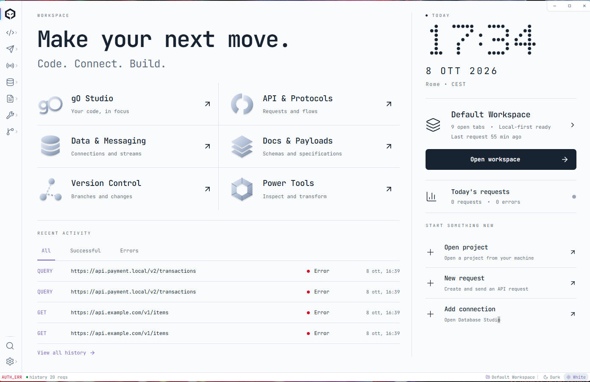
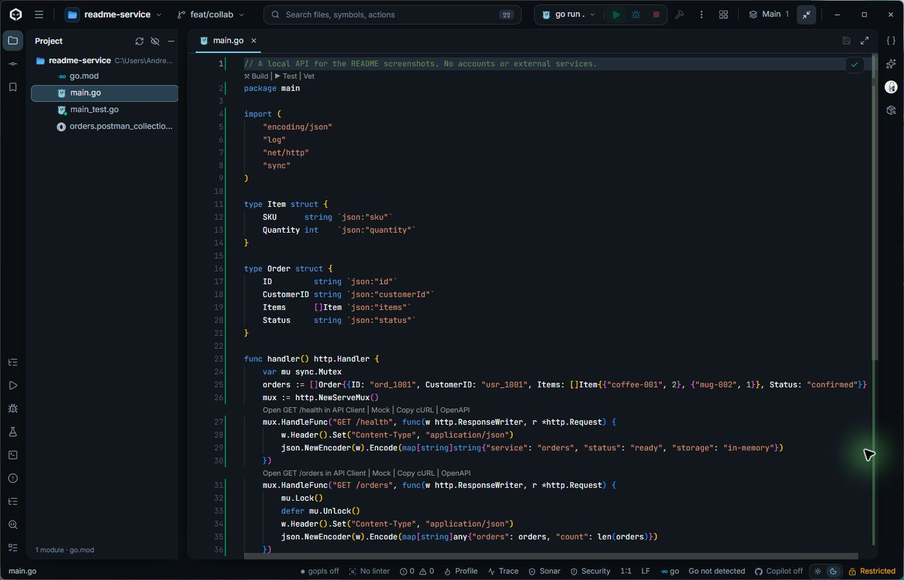
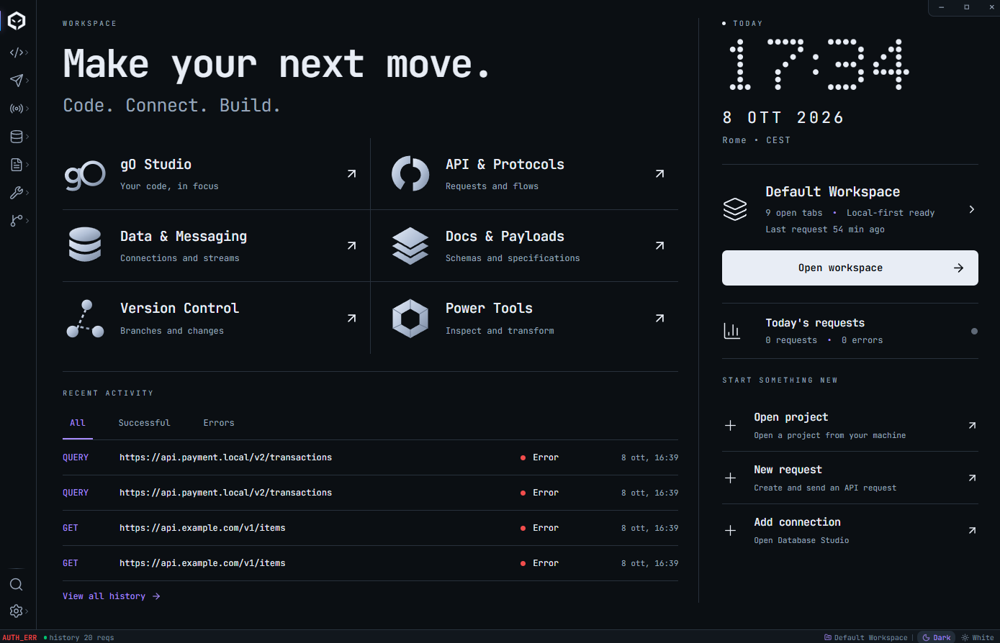
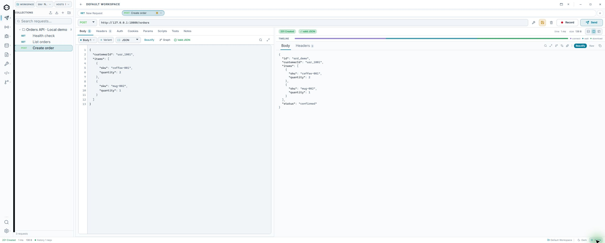

  

  <strong>API development, Go debugging and service inspection in one desktop application.</strong> 
  An API workbench and Go IDE with database, messaging, logs and profiling tools.

  <a href="https://github.com/Andrea-Cavallo/adOmnia/releases/latest">Download</a> ·
  <a href="https://www.youtube.com/watch?v=tefwLUadRr8&amp;t=38s">Watch the demo</a> ·
  <a href="docs/GETTING-STARTED.md">Getting started</a> ·
  <a href="docs/QUICKSTART.it.md">Guida in italiano</a>

## Screenshots

  
  
  

  
  

## Demo
