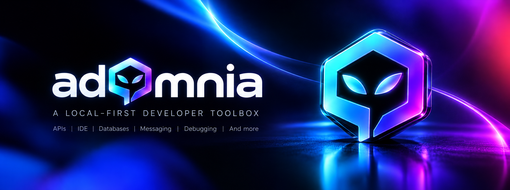
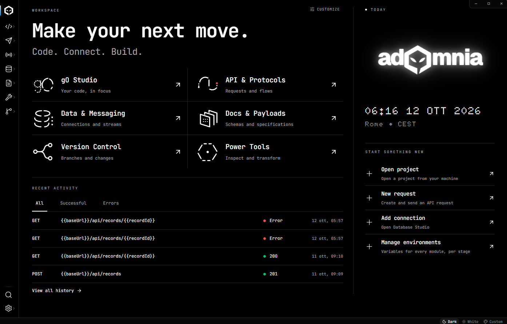
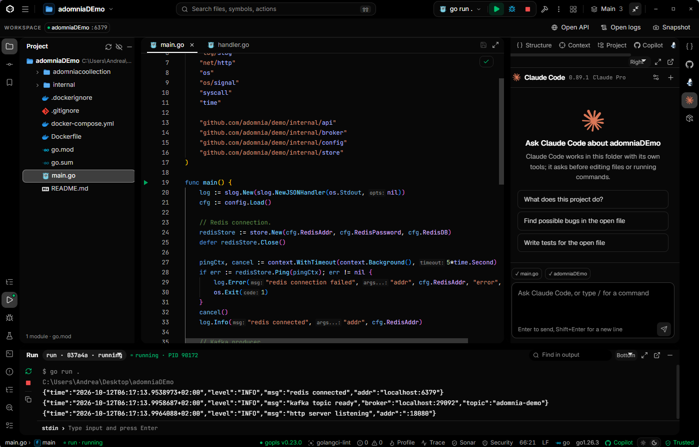
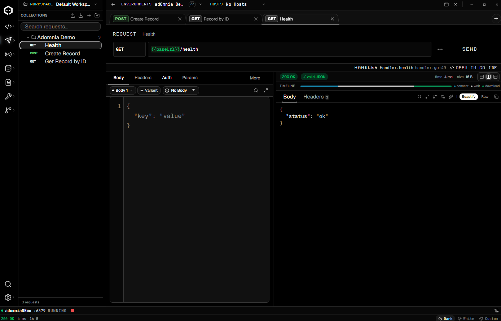
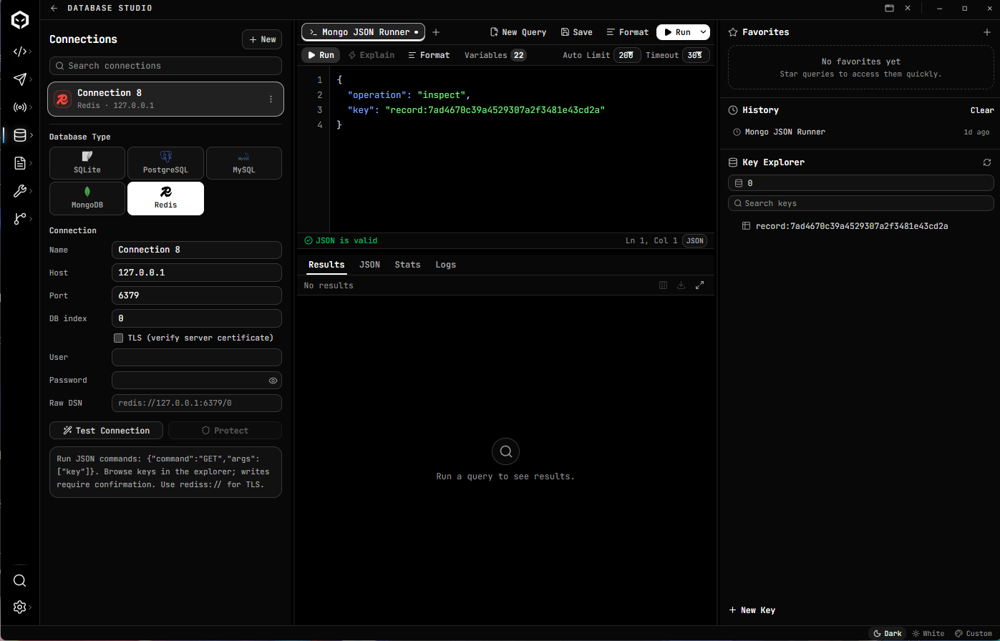
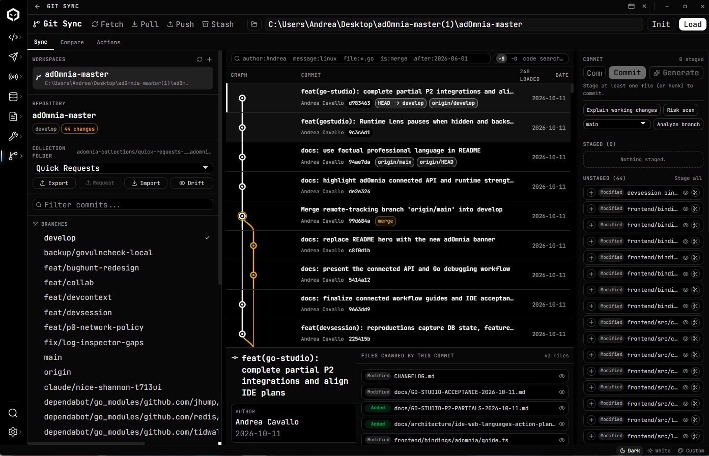
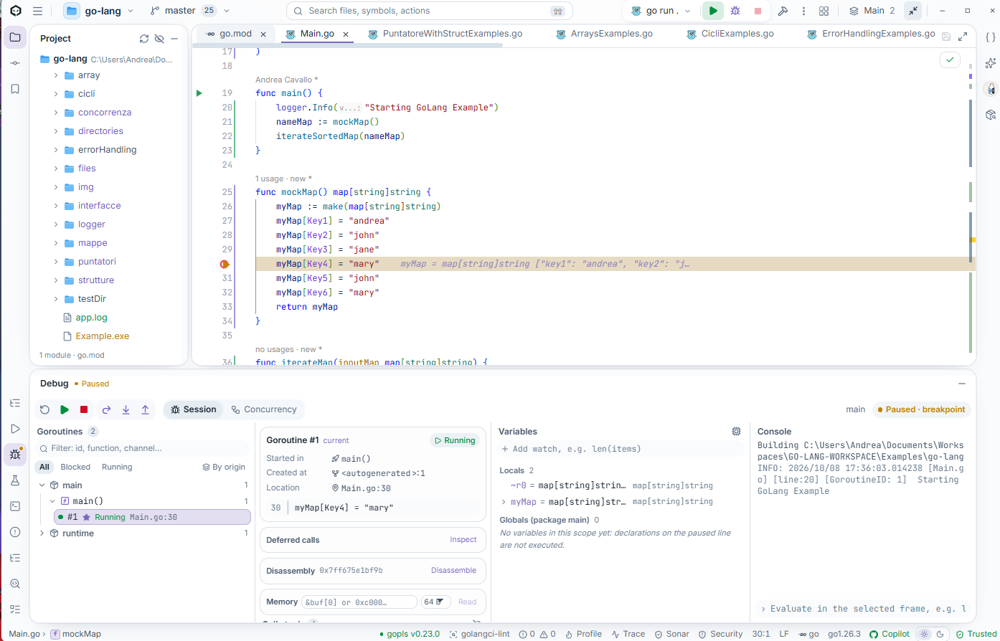

<p align="center">
  
</p>

<p align="center">
  <strong>API development, Go debugging and service inspection in one desktop application.</strong><br>
  An API workbench and Code Studio with database, messaging, logs and profiling tools.
</p>

<p align="center">
  <a href="https://github.com/Andrea-Cavallo/adOmnia/releases/latest">Download</a> ·
  <a href="https://www.youtube.com/watch?v=tefwLUadRr8">Watch the demo</a> ·
  <a href="docs/GETTING-STARTED.md">Getting started</a> ·
  <a href="docs/QUICKSTART.it.md">Guida in italiano</a>
</p>

<p align="center">
  <strong>English</strong> · <a href="README.es-ES.md">Español</a> · <a href="README.ja.md">日本語</a> · <a href="README.zh-CN.md">简体中文</a>
</p>

## adOmnia is written in Go!

<p align="center">
  Kubernetes is written in Go<br>
  Prometheus is written in Go<br>
  Terraform is written in Go<br>
  Docker is written in Go<br>
  Google created Go<br>
  Cloudflare uses Go<br>
  Uber uses Go<br>
  Dropbox uses Go<br>
  Twitch uses Go<br><br>
  <strong>Fast compilation. Simple concurrency. Built for infrastructure.</strong><br>
  <strong>Go is the way to Go. adOmnia is written in Go: speed is the point.</strong>
</p>

## One window for your code, your endpoints, your debugger and your database

A backend developer's day is usually an editor, a terminal, an API client, a database GUI, a Docker dashboard, a Kafka tool and a browser with DevTools, none of which know about each other. adOmnia ends the switching: a local-first desktop IDE whose centerpiece is **Code Studio**, wrapping every tool you touch in one minimal, modern interface where the code, the endpoints, the debugger, the database and the brokers know about each other. [Watch it in action](https://www.youtube.com/watch?v=tefwLUadRr8&t=24s).

- **An IDE, not a text editor with plugins.** gopls completion, diagnostics and refactorings, run/test/debug from the gutter, a Delve debugger (launch, attach or remote), pprof and escape-analysis workbenches, a Git workbench with hunk staging, and several isolated projects open at once. Java and Spring, and the web languages, follow the same standards.
- **Endpoints discovered from the code.** Opening a project builds a local map of modules, services, datasources, `.env` variables, OpenAPI/proto/WSDL contracts and HTTP routes (net/http, gin, echo, chi, gorilla; Spring MVC). Press `Ctrl+K` to jump to a route, table, topic or service and act on it: send it, open its handler, mock it, query it. No more copying ports into an API client.
- **Debug a request, not just a function.** *Debug Request* starts your service under the debugger, waits for the port, sends the request and stops on the breakpoint that handles it. Requests can target a service by name, resolved to your local run, a Compose port or a remote URL, and show the SQL and Kafka traffic they cause.
- **Database, brokers and Docker in the same interface.** Database Studio (PostgreSQL, MySQL/MariaDB, MongoDB with an explorer and aggregation builder), Broker Studio, Docker Lab, Mock Server, Proxy and Browser Debugging, load testing, WebSocket/SSE/gRPC/SOAP clients. Opening a tool from a detected service arrives already configured.
- **Minimal, modern and yours to shape.** One design language across every panel, light and dark themes, importable skins, a JavaScript plugin system, shareable templates and Git-friendly workspaces.
- **Local-first.** No cloud, no account, no telemetry. Project tools run only after you explicitly trust a project, and every tool install shows its exact command first. One portable executable, written in Go: it starts fast and stays fast.

The glue between the tools is the product: when the IDE knows your routes, the API client knows which service to start, the debugger can stop inside the request you just sent and the database tool is already on the right schema, the loop from *I changed a line* to *I saw what it did* collapses from minutes to seconds.

## Screenshots

### Workspace Hub

Start from the main workspace, review recent activity and open the area you need: Code Studio, API and protocols, data and messaging, documentation, version control or power tools.

<p align="center">
  
</p>

### Code Studio

Edit and run a Go service with its project tree, source editor, terminal and contextual AI assistance visible in the same workspace.

<p align="center">
  
</p>

### API Workspace

Organize requests in collections, send them to the running service and inspect the response. Recognized routes link directly to their Go handler.

<p align="center">
  
</p>

### Database Studio

Connect to SQLite, PostgreSQL, MySQL, MongoDB or Redis, write queries and inspect results, keys and history without leaving the application.

<p align="center">
  
</p>

### Git Sync

Inspect branches and commit history, review changed files, stage selected work and run fetch, pull, push or stash operations from the repository view.

<p align="center">
  
</p>

## Demo

**[▶ Watch the demo on YouTube](https://www.youtube.com/watch?v=tefwLUadRr8)**

*API Workspace showing a request, its response and the associated Go handler. Select the image to watch the demonstration.*

## API development and service debugging

adOmnia combines API testing and Go development. Requests can be linked to detected handlers, executed against a running service and inspected in the debugger. Database, messaging, log and trace tools share the application. With capture configured, follow the SQL, messages and logs associated with the live request.

A Go service started in **Code Studio** becomes a **live development session**. **API Workspace** can call and debug it; recognized routes link back to their source. Logs and configured SQL/broker captures are part of the same workflow.

```text
WRITE              RUN                CALL                 UNDERSTAND
Code Studio    →    Live service    →    API Workspace    →    Handler / breakpoint
                                                                ↕
                                                    Variables · logs · SQL · messages
```

### Core capabilities

| Capability | Description |
| --- | --- |
| **API testing and source navigation** | Reusable collections, environments, authentication and assertions, with a direct route into recognized Go handlers. Start with an API, then follow its implementation into the running code. |
| **Request-driven debugging** | Debug Request starts or reuses a compatible Delve session. Inspect frames, variables and goroutines, step through the handler and return to the response. |
| **Data and events beside the request** | Database, Broker, Log and Trace tools share the application. With capture configured, follow the SQL, messages and logs associated with the live request. |
| **Go development and profiling** | gopls editing and navigation, test/coverage workflows, Delve, pprof, execution traces and architecture/impact views connect source-level work with runtime investigation. |
| **Enterprise protocols in the same workflow** | HTTP, SOAP/WSDL, WS-Security, gRPC, WebSocket/SSE, mTLS and certificate tools support both modern APIs and existing systems. |
| **Dependency security with reviewed fixes** | Security Center scans `pom.xml` and `go.mod`, separates severity from exploitation signals, and previews the security impact of an upgrade before it happens. Safe remediation shows the diff, runs the checks and applies only after your review. |
| **Local storage and multiple windows** | Local collections and settings, exportable data, multiple Go projects and native studio windows. Arrange the IDE, API client and supporting tools across windows. |

### Storage and external services

**No account required to use the application.** Collections, settings and project state stay local. You choose the APIs, databases, brokers and optional AI providers to connect to. External providers and local services are chosen explicitly.

### Projects and windows

Keep a service in Code Studio, its requests in API Workspace and its database or broker beside them. Open another Go project in its own native window while staying inside the same adOmnia instance.

The workflow preserves links between the project, service session, API request and available diagnostic evidence.

## Start with your API

1. Open **API Workspace** and create a collection and request.
2. Choose a method and URL. Configure **Body**, **Headers**, **Params** and authentication.
3. Choose an environment for reusable values such as `{{baseUrl}}`.
4. Press **SEND**. Inspect the status, timing, response body, headers and test results.
5. Save the request to rerun it or share an export.

You can use the API tools without opening a Go project.

| Workflow | Tools in the same workspace |
| --- | --- |
| Test HTTP APIs | Collections, environments, authentication, response inspection and assertions |
| Work with enterprise protocols | SOAP/WSDL, WS-Security, gRPC, mTLS and certificate tools |
| Follow live connections | WebSocket and SSE clients |
| Reproduce responses | Mock server and proxy/interceptor tools |
| Inspect service data | Database Studio and Broker Studio |
| Understand failures | Browser debugging, logs, traces and the connected Go debugger |

## Follow a request into Go code

1. Open the service in **Code Studio → File → Open Project**.
2. Trust the folder to enable Go tools. Configure the SDK and Run/Debug configuration.
3. Set a handler breakpoint and start debugging, or use **Debug Request** from the API request actions.
4. Send the matching request. For a recognized route, the **HANDLER** strip links to its source with **OPEN IN GO IDE**.
5. Inspect the paused frame, variables, stack and goroutines. Step or continue, then return to the response.

SQL, broker messages and logs enrich this workflow when capture/instrumentation is configured. They are not automatically available for every service. See [the walkthrough](docs/GETTING-STARTED.md) for a first setup.

## Code Studio: the IDE inside the workflow



*Code Studio paused at a breakpoint, with source code, goroutines, variables and console output. Controls may differ between releases.*

- **Edit and navigate:** gopls completion, diagnostics, references, rename, refactoring, project search and Git.
- **Run, test and debug:** Go configurations, test explorer, coverage and Delve with conditional breakpoints and goroutine inspection.
- **More than Go:** TypeScript/JavaScript and web projects (Vite/npm scripts, Vitest/Jest results, Live Preview) and Java (Maven/Gradle, JUnit, Spring Boot, breakpoints and remote attach) use the same run, test and debug interface. In `pom.xml`, check for newer versions on Maven Central and scan dependencies for known vulnerabilities, with a one-click version update. Language servers and debuggers are installed only after you confirm the exact command.
- **Understand the project:** routes, dependencies, interfaces, architecture and change-impact views.
- **Measure behavior:** pprof profiles, execution traces, benchmarks and concurrency tools.
- **Keep work together:** terminal, local history, recovery snapshots and multiple projects/windows within one adOmnia instance.
- **AI assistance:** contextual assistance with configured providers and project policies; review changes before applying them.

Open another project from the project selector. Choose **Open Project in New Window** to place it beside the first IDE; save or discard unsaved files before moving it. Use the **Studios** menu for surrounding tools and workspaces.

[Read the Code Studio guide →](docs/CODE-STUDIO.md) · [Technical reference: the IDE platform →](docs/CODE-STUDIO-REFERENCE.md)

## Download and install

Get adOmnia from **[GitHub Releases](https://github.com/Andrea-Cavallo/adOmnia/releases/latest)**. Check the release page for available assets and known limitations.

| Platform | Download | Setup |
| --- | --- | --- |
| Windows x64 | `adomnia-<version>-windows-amd64.exe` | Requires WebView2; executable/per-user installation, not an MSI wizard |
| macOS Intel / Apple Silicon | `adomnia-<version>-macos-universal.dmg` | Install from the DMG; check signing details in release notes |
| Linux x64 | `adomnia-<version>-linux-amd64-gtk3-webkitgtk-4.1.tar.gz` | Requires GTK 3 and WebKitGTK 4.1 |

Check for updates in **Settings**. Update packages verify the publisher signature and checksum; installation asks for confirmation. OS code signing is separate from updater package signing.

[Installation and updates](docs/INSTALL.md) · [Release notes and support limits](docs/releases/v1.0.0.md)

## What is experimental

LAN collaboration is **beta and opt-in**. Standalone LaTeX, Kubernetes/OpenShift, plugin marketplace and Hub games are hidden from v1 navigation. Imported PDFs still open the complete PDF editor, but platform support is limited by the underlying OS and toolchain.

## Documentation

| Start here | What it helps you do |
| --- | --- |
| [Getting started](docs/GETTING-STARTED.md) · [Italian guide](docs/QUICKSTART.it.md) | Send requests, connect a Go project and debug a handler |
| [Installation](docs/INSTALL.md) | Install, update and check platform requirements |
| [Code Studio](docs/CODE-STUDIO.md) | Configure projects, tools, tests, debugger and editor |
| [Code Studio technical reference](docs/CODE-STUDIO-REFERENCE.md) | Understand the IDE platform: architecture, modules, language adapters, UI and bindings |
| [Live sessions](docs/LIVE-SESSION.md) | Connect requests with code, logs, SQL and messages |
| [Feature reference](docs/adomnia-feature-catalog.en.md) | Explore the supporting studios |
| [Troubleshooting](docs/TROUBLESHOOTING.md) · [FAQ](docs/FAQ.md) | Resolve setup and workflow problems |
| [Build from source](docs/BUILD.md) · [Contributing](CONTRIBUTING.md) | Build the application and contribute |

## Feedback and contributions

[Report an issue](https://github.com/Andrea-Cavallo/adOmnia/issues) with your version, operating system and reproduction steps. Remove credentials and private data from screenshots and exports. Follow repository contribution guidelines before opening a pull request.

[MIT license](LICENSE.md)
