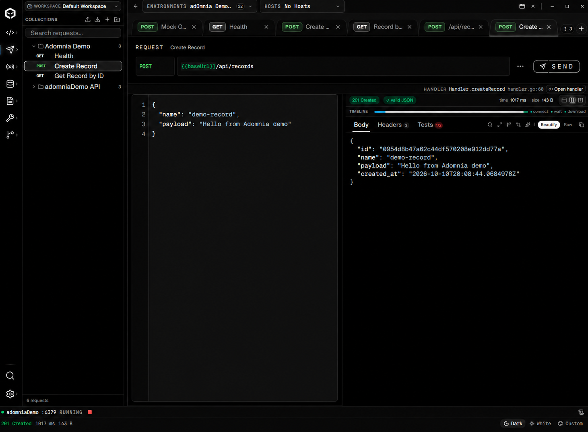

# Your first connected workflow

Start with API Workspace. Add Code Studio when you want to follow a request into your own service. No Go project is needed to call an existing API.

## 1. Send and save a request

Create a collection in API Workspace and add a request. Choose its method, enter a URL you can reach and configure Body, Headers, Params and Auth as needed. For JSON, select the JSON body type and check the content type expected by the server.

Press SEND. The response shows status, elapsed time and payload. Inspect response headers and add assertions in Tests. Save the request with a useful name.

## 2. Reuse environments

Create an environment, add `baseUrl` with your service address and select it in the header. Use `{{baseUrl}}/api/records` instead of repeating the host in every request. The path is an example: use an endpoint that exists in your service.

Keep credentials in private variables or the vault. Review exports before sharing them. Workspace selects the collection context; Environment selects variables; Hosts selects host profiles. These controls serve different purposes.

## 3. Open and run your Go service

In Code Studio, use File → Open Project and select the service folder. A `go.mod`, `go.work` or project folder is supported. Trust a folder you control to enable tools and process execution. Select the Go SDK and create/select the Run configuration for the service's main package.

Start Run and check its console and listening port. Point the API environment at that actual port. A connection-refused response usually means the service is stopped or the address/port does not match.

## 4. Debug the request

Set a breakpoint in the handler. Start a Debug configuration, or choose Debug Request from the API request actions to start/reuse a compatible session. Keep route, project and service address aligned; route detection is not guaranteed for every framework or dynamically registered endpoint.

Send the request. At a breakpoint, inspect locals, watches, frames and goroutines in Code Studio. Continue execution to obtain the response. The HANDLER strip provides OPEN IN GO IDE when the route is recognized.

## 5. Inspect what the request touched

Use the live session's logs and timeline. SQL capture and broker watching need explicit configuration; consult [Live Sessions](LIVE-SESSION.md) for supported transports and limits. Open a captured query in Database Studio to inspect it; navigation does not automatically execute the query. Open a message's topic in Broker Studio.

Save a reproduction when available to keep the request and captured evidence together. Review the exported files and remove sensitive data before sharing.

## 6. Work with multiple projects

Open another project from the project selector. Switch between open projects or use Open Project in New Window. Save or discard dirty files before transferring a project. The windows belong to the same adOmnia application; API Workspace and supporting studios remain connected to its backend.

The main IDE remembers its last selected project per workspace after you select it in a build containing that fix. Detached project windows keep their own project.

## When something does not work

| Symptom | Check |
| --- | --- |
| Connection refused | Service running, listening port, URL and selected environment |
| Breakpoint never stops | Debug configuration, correct handler/project, executable and request route |
| No HANDLER link | Project loaded, supported route detected, method/path match |
| No SQL/messages | Capture/watch enabled, supported connection, service emits the required evidence |
| Tools unavailable | Project trust, SDK and optional gopls/Delve installation |

[Watch the demo from 0:38](https://www.youtube.com/watch?v=tefwLUadRr8&t=38s) · [Code Studio reference](CODE-STUDIO.md) · [Troubleshooting](TROUBLESHOOTING.md)
