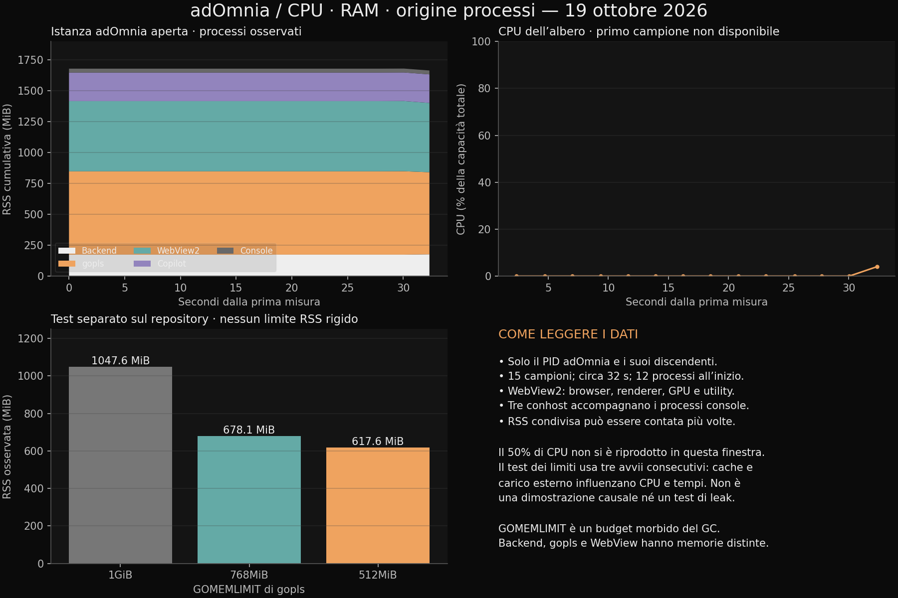

# CPU, RAM e processi — 2026-10-19



Dati grezzi: [15 campioni OS in JSON](resources-baseline-2026-10-19.json) e [output della prova gopls](gopls-limits-2026-10-19.txt). La baseline OS è stata raccolta esternamente tramite CIM; non contiene i contatori del runtime Go aggiunti al nuovo monitor.

## Osservazione dell'istanza aperta

Quindici campioni OS su Windows, per 32,34 secondi, normalizzati su 28 processori logici. Sono inclusi soltanto il PID di adOmnia osservato e i suoi discendenti; gli altri WebView2 del sistema sono esclusi. Il primo valore CPU non è disponibile perché manca un campione precedente. RSS complessiva circa 1.680 MiB, ultimo campione circa 1.665 MiB; CPU quasi nulla nella finestra, con picco finale circa 4% della capacità totale. **Il 50% segnalato non è stato riprodotto**: questa osservazione breve non identifica la causa di un picco precedente e non è una prova di assenza di leak.

| Gruppo | Processi iniziali | RSS iniziale approssimativa |
|---|---:|---:|
| Backend adOmnia | 1 | 174 MiB |
| gopls | 1 | 675 MiB |
| WebView2 | 6 | 569 MiB |
| Copilot language server | 1 | 231 MiB |
| Console host Windows | 3 | 32 MiB |

I sei WebView sono un albero del browser incorporato, con browser/renderer/GPU/utility separati. I tre `conhost.exe` sono figli osservati di adOmnia, Copilot e gopls. Il PID padre è un'osservazione OS, non una traccia storica completa dell'avvio: i processi terminati o riparentati non consentono di ricostruire retroattivamente ogni chiamante. L'attribuzione al progetto è più forte quando Code Studio registra il processo gestito.

## Misura gopls sul repository

Comando ripetibile, con `ADOMNIA_MEASURE_LSP_ROOT` impostato alla root e `ADOMNIA_MEASURE_LSP_BINARY` al binario locale:

```powershell
go test ./internal/codestudio -run '^TestMeasureLanguageServerMemory$/(1GiB|768MiB|512MiB)/full$' -count=1 -timeout 10m -v
```

| GOMEMLIMIT | RSS osservata | Caricamento | Primo hover | CPU cumulativa user+system |
|---|---:|---:|---:|---:|
| 1 GiB | 1047,6 MiB | 7870 ms | 3960 ms | 103,47 CPU-s |
| 768 MiB | 678,1 MiB | 6384 ms | 162 ms | 32,42 CPU-s |
| 512 MiB | 617,6 MiB | 7933 ms | 121 ms | 27,03 CPU-s |

CPU-s è tempo cumulativo su tutti i thread, non percentuale. Un solo passaggio in quest'ordine: cache di compilazione, inizializzazione e carico esterno influenzano il risultato; non attribuire causalmente le differenze di CPU al solo limite. Hover e simboli funzionano con tutti i limiti; il processo termina alla chiusura del workspace. La RSS può superare GOMEMLIMIT perché è un budget morbido del GC, non un tetto di memoria del processo.

`TestGoplsMemoryLimitRestartRetainsOverlay`: passaggio 768 → 512 MiB, vecchio PID terminato, nuovo limite nello spec e hover del valore non salvato `42` conservato. Riavvio più hover: **548 ms** sulla piccola fixture. Non è una garanzia di latenza su un workspace grande.

## Flusso implementato

Dal monitor risorse nella status bar o nella stripe di Code Studio:

- Il backend parte con budget GC di 512 MiB se non esiste un `GOMEMLIMIT` esplicito. Un valore scelto nell'app prevale finché non si ripristina `0`; `0` ripristina il valore di avvio (ambiente, oppure 512 MiB). L'applicazione del limite è immediata e non chiude i buffer.
- gopls conserva il default precedente di 768 MiB o il valore dell'ambiente. Il controllo salva il limite globale editor e riavvia soltanto il progetto Go selezionato; gli altri lo useranno al successivo riavvio. Nessun riavvio automatico di Java o WebView.
- Registrazioni da 30/60/120 secondi a circa 1 Hz, massimo 300 campioni, con scenario modificabile. L'osservazione normale resta a 5 secondi e rispetta l'inattività; la registrazione esplicita continua in idle ma salta la finestra nascosta. Niente richieste di campionamento sovrapposte nello stesso monitor. Al termine la registrazione resta congelata per export e confronto; Cronologia live riprende l’osservazione.
- Grafici CPU/RAM con scale distinte e tempi effettivi, selezionabili per processo. CPU iniziale o non disponibile resta vuota. Identità storica PID + data di creazione.
- JSON con metodologia e tutti i campioni; CSV con una riga per processo e campione; Markdown di riepilogo; HTML autonomo con grafici e dati completi incorporati, senza CDN o script.
- Export con genitore osservato, ruolo WebView, proprietario registrato, progetto/sessione, eseguibile, GOMEMLIMIT, RSS, CPU cumulativa e intervallo effettivo, heap/GC del backend. Errori, campioni incompleti, copertura CPU parziale e limiti di raccolta sono espliciti. Argomenti completi e environment non sono esportati.

Persistenza additiva: `<dataDir>/resource-settings.json`, chiave `goMemoryLimitMiB`; file assente usa il default. Scrittura prima dell'applicazione, atomica tramite file temporaneo; errori non cambiano il limite attivo. Le impostazioni gopls aggiungono `memoryLimitMiB` opzionale al record frontend esistente; assente/zero preserva il comportamento precedente. Nessuna migrazione dei workspace.

Verifiche desktop della nuova build: vedere esclusivamente `RES-1.M1`–`RES-1.M3` in `mds/MANUAL-CHECK.md`.


## Verifiche automatiche eseguite

| Verifica | Esito |
|---|---|
| `go test ./... -timeout 10m` con `LEFTHOOK=0` nel processo di test | PASS; `internal/codestudio` 126,158 s |
| `go test ./internal/resources -race -count=1` | PASS |
| `go test ./internal/languages/golang ./internal/ide -count=1` | PASS, comprese regole architetturali |
| Test gopls reale 1 GiB/768/512 MiB | PASS; dati grezzi collegati sopra |
| `TestGoplsMemoryLimitRestartRetainsOverlay` con gopls installato | PASS; 548 ms riavvio + hover |
| Suite frontend completa | PASS: 415 file, 2063 test |
| TypeScript e build frontend | PASS |
| Controllo startup | PASS: nessun modulo deferred nello startup; sotto 650.000 byte |
| `go build -o NUL .` | PASS; eseguibile utente preservato |

La prima suite Go ha raggiunto il timeout su un `git commit` di fixture che invocava l'hook Git globale non risolvibile di questa macchina. Il test isolato con `LEFTHOOK=0` passa in 3,04 s; la suite completa ripetuta con lo stesso ambiente passa. Nessuna configurazione Git globale è stata modificata. Prove browser: tema chiaro/scuro, selezione del grafico gopls, limite invalido e stato d'errore che mantiene i controlli disponibili; non equivalgono al collaudo della finestra Wails.
